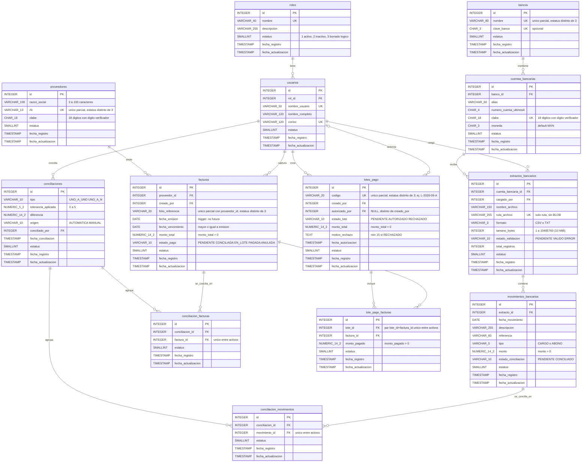

# CashMatch ERP - Diagrama Entidad-Relacion (Fase 1)

Base de datos PostgreSQL `cashmatch_erp`, esquema `public`. Script: `base_datos_proyecto.sql`.

Las tres columnas de auditoria (`estatus`, `fecha_registro`, `fecha_actualizacion`) existen en **todas** las tablas, incluidas las puente. Aparecen en el diagrama en cada entidad.

- `estatus SMALLINT NOT NULL DEFAULT 1 CHECK (estatus IN (1,2,3))` : 1 = activo, 2 = inactivo, 3 = borrado logico.
- `fecha_registro TIMESTAMP NOT NULL DEFAULT CURRENT_TIMESTAMP`
- `fecha_actualizacion TIMESTAMP NOT NULL DEFAULT CURRENT_TIMESTAMP` (refrescada por el trigger `fn_actualizar_fecha_actualizacion()` en cada UPDATE).

## Normalizacion (3FN)

- **1FN**: todos los atributos son atomicos; no hay listas ni grupos repetidos (las relaciones N:M se resuelven con tablas puente).
- **2FN**: cada tabla tiene PK simple (`id` identidad); ningun atributo depende de una parte de una clave compuesta. Las tablas puente tambien tienen PK propia y la pareja de FK se protege con indices unicos parciales.
- **3FN**: no hay dependencias transitivas: los datos del banco viven en `bancos`, los del proveedor en `proveedores`, el rol en `roles`; las tablas hijas solo guardan la FK. Los montos agregados (`lotes_pago.monto_total`, `conciliaciones.diferencia`) son valores capturados por regla de negocio al momento de la operacion (foto del lote), no se derivan de otra columna de la misma fila.

## Decisiones de diseno

1. **Auditoria y borrado logico**: `estatus` (1/2/3) es solo ciclo de vida del registro. Los estados de negocio van en columnas `estado_*` separadas. El rol de BD `cashmatch_app` tiene SELECT, INSERT y UPDATE, **sin DELETE ni DDL**, lo que fuerza el borrado logico en la propia base.
2. **`fecha_actualizacion`**: una funcion de trigger unica (`fn_actualizar_fecha_actualizacion`) y un trigger `BEFORE UPDATE` por tabla, porque el DEFAULT de PostgreSQL no se aplica en UPDATE.
3. **Cargo/abono**: `tipo` ('CARGO'/'ABONO') + `monto > 0`; el sentido lo da `tipo`, evita signos ambiguos.
4. **Archivos**: solo `ruta_archivo VARCHAR(255)` con CHECK de formato (`/uploads/extractos/<nombre>.csv|txt`, sin `..`); nunca BLOB/BYTEA/Base64. Limite de 10 MiB (10485760 bytes) en `tamano_bytes`. La ruta es logica, con `/` inicial (`/uploads/extractos/...`), no una ruta absoluta del sistema de archivos.
5. **Fecha de emision no futura**: `CURRENT_DATE` no es inmutable y no puede usarse en CHECK; se implementa con el trigger `trg_facturas_validar_fecha_emision`.
6. **Unicidad entre activos**: un movimiento o una factura solo puede estar en una conciliacion activa (indice unico parcial `WHERE estatus = 1`), de modo que anular logicamente una conciliacion libera sus elementos. Tambien en `lote_pago_facturas` el indice unico parcial `uq_lote_pago_fac_par_activo (lote_id, factura_id) WHERE estatus = 1` impide repetir la misma factura dentro de un lote activo. Los UNIQUE de negocio que deben permitir re-alta tras un borrado logico son **indices unicos parciales `WHERE estatus <> 3`**: `uq_proveedores_rfc_vigente (rfc)`, `uq_bancos_nombre_vigente (nombre)`, `uq_facturas_proveedor_folio_vigente (proveedor_id, folio_referencia)` y `uq_lotes_pago_codigo_vigente (codigo)`. Siguen siendo UNIQUE totales (tambien frente a borrados logicos) `roles.nombre`, `usuarios.nombre_usuario/correo`, `bancos.clave_banco`, `cuentas_bancarias.clabe` y `extractos_bancarios.ruta_archivo`.
7. **Segregacion de funciones**: `CHECK (autorizado_por <> creado_por)`; motivo de rechazo obligatorio (>= 15 caracteres sin contar espacios, tabuladores ni saltos de linea en los extremos: `regexp_replace(motivo_rechazo, '^\s+|\s+$', '', 'g')`) cuando el lote es RECHAZADO; autorizador y fecha obligatorios cuando es AUTORIZADO.
8. **Seguridad de datos**: la CLABE completa se guarda en BD (necesaria para dispersar). El enmascarado (`***4401`) se aplica en la capa API o con la vista `v_proveedores_publico` (`WITH (security_barrier = true)`, solo proveedores con `estatus <> 3`). La CLABE (`cuentas_bancarias.clabe` y `proveedores.clabe`) se valida con `fn_clabe_valida(text)` (18 digitos + digito verificador, pesos 3-7-1). `usuarios` no almacena contrasenas (la autenticacion esta fuera de alcance de la Fase 1).
9. **Indices**: en todas las FK y, parciales `WHERE estatus = 1`, en `estado_pago`, `fecha_vencimiento`, `estado_lote`, `estado_conciliacion`, `fecha_movimiento` y `estado_validacion`.
10. **Regla de negocio no modelada en BD**: la coherencia entre `estado_pago` de la factura y el estado de su lote/conciliacion la orquesta la capa de servicio (no se duplican triggers de flujo en esta fase).

## Rol de aplicacion, vista, funciones y triggers

**Rol `cashmatch_app`** (NOLOGIN; el DBA habilita el login fuera del repositorio): `SELECT, INSERT, UPDATE` solo sobre las 13 tablas base (lista explicita), `SELECT` unicamente sobre la vista `v_proveedores_publico` (con `REVOKE INSERT, UPDATE, DELETE, TRUNCATE` explicito), `USAGE, SELECT` en secuencias, sin `DELETE`, `TRUNCATE` ni `CREATE`. `ALTER DEFAULT PRIVILEGES` concede por defecto solo `SELECT` en tablas/vistas futuras (sin DELETE, y una vista nueva nunca nace escribible); las tablas nuevas requieren `GRANT INSERT, UPDATE` explicito.

**Funciones** (todas `plpgsql`, sin `SECURITY DEFINER` ni SQL dinamico):

| Funcion | Uso |
|---|---|
| `fn_actualizar_fecha_actualizacion()` | refresca `fecha_actualizacion` en cada UPDATE (13 triggers `trg_<tabla>_fecha_actualizacion`) |
| `fn_proteger_fecha_registro()` | rechaza cambiar `fecha_registro` (13 triggers `trg_<tabla>_proteger_fecha_registro`) |
| `fn_validar_fecha_emision_factura()` | `fecha_emision` no futura (INSERT/UPDATE en `facturas`) |
| `fn_proteger_factura_no_pendiente()` | con `estado_pago` previo distinto de PENDIENTE, `monto_total`, `proveedor_id`, `folio_referencia` y `creado_por` no cambian |
| `fn_proteger_lote_pago()` | con `estado_lote` previo distinto de PENDIENTE, `monto_total`, `creado_por` y `codigo` no cambian; AUTORIZADO y RECHAZADO son estados finales: no cambia el estado ni `autorizado_por`, `fecha_autorizacion` o `motivo_rechazo` |
| `fn_proteger_lote_pago_factura()` | trigger `trg_lote_pago_facturas_proteger_lote_decidido` en `lote_pago_facturas`: si el lote padre es AUTORIZADO o RECHAZADO, `lote_id`, `factura_id` y `monto_pagado` no cambian |
| `fn_proteger_movimiento_conciliado()` | con `estado_conciliacion = CONCILIADO`, `monto`, `tipo` y `fecha_movimiento` no cambian |
| `fn_clabe_valida(text)` | IMMUTABLE; usada en los CHECK de CLABE |

Los cambios de `estatus` (borrado logico) y las transiciones de estado de negocio validas (p. ej. PENDIENTE -> AUTORIZADO/RECHAZADO, fijando `autorizado_por`, `fecha_autorizacion` o `motivo_rechazo`) siguen permitidos.

## Alcance delegado a la capa de servicio / Fase 2

La BD **no** garantiza: que una conciliacion `UNO_A_UNO` tenga exactamente 1 movimiento y 1 factura (cardinalidad por `tipo`); que la suma de `lote_pago_facturas.monto_pagado` coincida con `lotes_pago.monto_total`; ni una bitacora completa de cambios (la inmutabilidad parcial y `fecha_actualizacion` no sustituyen una auditoria de valores anteriores/nuevos). Estas reglas se implementan en la capa de servicio o en la Fase 2.

## Script y entorno

Ejecutar `psql` con `-v ON_ERROR_STOP=1` (sin ello psql continua tras un error y devuelve exit code 0). `base_datos_proyecto.sql` es **destructivo** (elimina y recrea todo): solo para desarrollo/CI. Aborta si `current_database()` no es `cashmatch_erp`.
